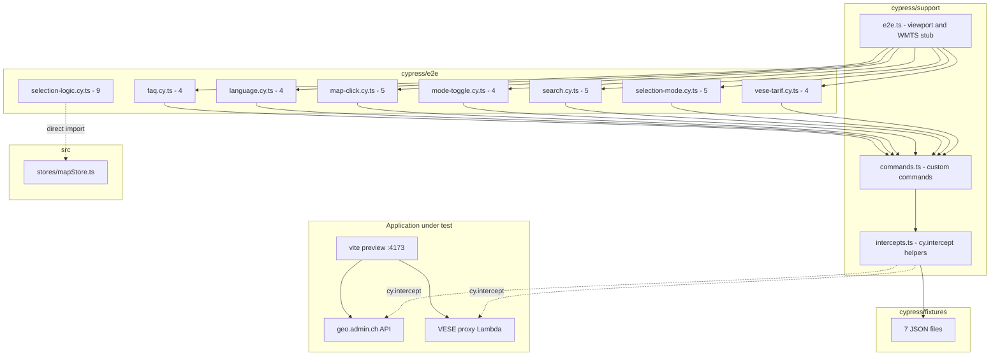
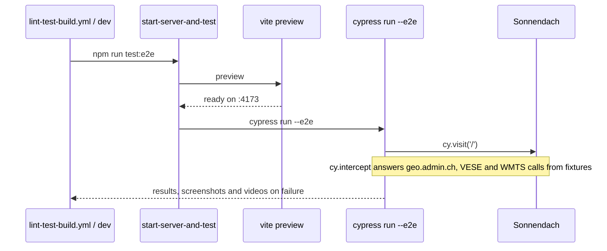

# Design Document: Cypress E2E Tests

## Overview

This document describes the Cypress E2E test suite of Sonnendach **as built**: 8 spec files, 40 tests (31 UI tests and 9 logic tests), 7 fixtures and 3 support files. The suite covers address search, map click, surface selection (single / multiple), roofs/facades layer toggle, language switching, the FAQ accordion and the VESE tariff, including a regression guard that proves the VESE license key never reaches the browser. A logic spec checks the selection rules (aggregation, class thresholds, store actions) without opening a page.

All external API calls are intercepted with `cy.intercept()` and answered from local fixtures, so tests are deterministic and need no network. They run against the Vite preview server on `http://localhost:4173`, started by `start-server-and-test`.

**Key design decisions:**
- One spec file per functional area.
- Custom commands and intercept helpers hold every repeated setup pattern.
- Tests are defined once, in `lint-test-build.yml`: it runs on every pull request, and the frontend deployment on `main` calls it first and deploys only if it passes.
- The UI is tested in German (default language). Only `language.cy.ts` checks French.
- A full run takes about 50 s.

## Architecture



### Execution flow



## Components and Interfaces

### 1. Spec files (`cypress/e2e/`)

| File | Tests | Responsibility | Requirements |
|------|-------|---------------|--------------|
| `search.cy.ts` | 5 | SearchServer params, suggestions, selection triggers identify, InfoPanel and badge, 500 error | 2 |
| `map-click.cy.ts` | 5 | Click triggers identify, 3 sections, `badge-5`, loading state, no-data panel | 3 |
| `mode-toggle.cy.ts` | 4 | Dach/Fassade default and toggle, facade data, selection cleared on layer change | 4 |
| `selection-mode.cy.ts` | 5 | Einzeln default, InfoPanel, SummaryBanner, no clear button in single mode, multiple mode and clear | 5 |
| `language.cy.ts` | 4 | DE default, FR translation, numbers preserved after switch, `?lang=fr` | 6 |
| `faq.cy.ts` | 4 | 9 questions, open/close, icon, `aria-expanded` | 7 |
| `vese-tarif.cy.ts` | 4 | `idofs=351`, provider and tariff, 503 fallback, key never in the browser | 8 |
| `selection-logic.cy.ts` | 9 | `aggregateSurfaces` and `useMapStore`: sums, heat demand once per building, class thresholds per layer, class split, orientation for one surface only, no duplicates, single mode replaces, mode vs layer change, uncapped heat coverage | 12 |

`selection-logic.cy.ts` never calls `cy.visit`. It imports `../../src/stores/mapStore` and `../../src/types/solar` by relative path (the `@` alias is not configured for the Cypress bundler) and calls `setActivePinia(createPinia())` before each store test. The global `beforeEach` of `e2e.ts` still runs (viewport and WMTS stub), which is harmless. The spec needs the preview server only because `cypress run` checks that `baseUrl` answers. It runs in under a second.

### 2. Support files (`cypress/support/`)

#### `e2e.ts` — global setup
- Imports `commands.ts`.
- `beforeEach`: viewport 1280x720 and `cy.intercept('GET', '**/wmts/**', { statusCode: 200, body: '' })` (alias `tileRequest`).

#### `intercepts.ts` — intercept helpers

| Helper | Intercepts | Alias |
|--------|-----------|-------|
| `setupSearchIntercept(fixture = 'search-results.json')` | `GET https://api3.geo.admin.ch/rest/services/api/SearchServer*` | `searchRequest` |
| `setupIdentifyIntercept(fixture = 'identify-roofs.json')` | `GET .../MapServer/identify*` | `identifyRequest` |
| `setupFindIntercept(fixture = 'identify-roofs.json')` | `GET .../MapServer/find*` (building surfaces **and** GWR lookup) | `findRequest` |
| `setupVeseIntercept({ error, muniFixture, evuFixture })` | `GET /\/muni\?/` and `GET /\/evu\?/` (503 if `error`) | `veseMuniRequest`, `veseEvuRequest` |

The VESE regexes match both the Vite dev proxy (`/api/pvtarif/muni?...`) and the production Lambda URL (`https://<id>.execute-api.<region>.amazonaws.com/muni?...`).

#### `commands.ts` — custom commands

```typescript
declare global {
  namespace Cypress {
    interface Chainable {
      /** search + identify + find stubs; `fixture` overrides identify and find */
      interceptGeoAdmin(fixture?: string): Chainable<void>
      /** muni + evu stubs; `error: true` answers 503 */
      interceptVese(options?: { error?: boolean }): Chainable<void>
      /** clear and type in input.search-input, wait for @searchRequest, click the first suggestion */
      searchAndSelect(address: string): Chainable<void>
      /** click the OpenLayers canvas at a pixel offset (force: true) */
      clickMap(x: number, y: number): Chainable<void>
    }
  }
}
```

`searchAndSelect` uses `input.search-input` and does **not** chain `.clear()` and `.type()` (lint rule `cypress/unsafe-to-chain-command`).

### 3. Fixtures (`cypress/fixtures/`)

| File | Content | Used by |
|------|---------|---------|
| `search-results.json` | SearchServer response with 5 addresses (Bahnhofstrasse 1 to 9, 3011 Bern) | search, language, vese-tarif |
| `identify-roofs.json` | 3 roof surfaces (`featureId` 90001 to 90003) of building `1234567`, all class 5 | all specs that select a surface |
| `identify-facades.json` | 2 facade surfaces (`featureId` 80001, 80002), classes 4 and 3 | mode-toggle |
| `identify-empty.json` | `{ "results": [] }` | map-click |
| `gwr-lookup.json` | GWR record for EGID 12345: `Bahnhofstrasse 1`, `3011`, `Bern`, `ggdenr: 351` | vese-tarif |
| `vese-muni.json` | `/muni` response, one EVU (`BKW Energie AG`, `idofs: 351`) | all specs using `interceptVese` |
| `vese-evu.json` | `/evu` response (`nomEw`, `energy1: 8.45`, `eco1: 0.50`) | vese-tarif |

> The error tests (SearchServer 500, VESE 503) define their stub inline. Two fixtures that no test used (`search-empty.json`, `error-500.json`) were deleted.

## Data Models

### Identify and find fixtures

The real swisstopo attributes are German. `identify-roofs.json` and `identify-facades.json` share this shape:

```typescript
interface IdentifyFixture {
  results: Array<{
    id: number
    layerBodId: 'ch.bfe.solarenergie-eignung-daecher' | 'ch.bfe.solarenergie-eignung-fassaden'
    layerName: string
    featureId: number            // unique per surface
    attributes: {
      building_id: number        // parent building
      df_uid: string
      flaeche: number            // area, m²
      gstrahlung: number         // total irradiation, kWh/year
      mstrahlung: number         // irradiation per m², kWh/m²/year
      stromertrag: number        // PV yield, kWh/year
      stromertrag_sommerhalbjahr: number
      stromertrag_winterhalbjahr: number
      waermeertrag: number       // heat yield, kWh/year
      bedarf_heizung: number     // building heating demand
      bedarf_warmwasser: number  // building hot water demand
      flaeche_kollektoren: number
      volumen_speicher: number
      klasse: number             // suitability class, 1..5
      finanzertrag: number       // CHF/year
      gwr_egid: number
    }
  }>
}
```

The fixtures contain **no** `ausrichtung` or `neigung`, so orientation and tilt show `-` in the InfoPanel.

### GWR fixture (`gwr-lookup.json`)

```typescript
interface GwrFixture {
  results: Array<{
    attributes: {
      egid: number
      strname_deinr: string   // "Bahnhofstrasse 1"
      dplz4: number           // 3011
      dplzname: string        // "Bern"
      ggdenr: number          // commune number, 351 -> drives the VESE call
    }
  }>
}
```

### VESE fixtures

```typescript
interface VeseMuniFixture {
  valid: boolean
  evus: Array<{ nrElcom: string; Name: string; idofs: string; PLZ: string; Gemeinde: string; uid: string }>
}

interface VeseEvuFixture {
  valid: boolean
  nomEw: string      // provider
  nrElcom: string
  energy1: string    // feed-in tariff, rp/kWh
  eco1: string       // ecological bonus
  ecoIncl: string    // '' means the bonus is added to energy1
  // also energy1_ht, energy1_nt, nbrPowerCat, power1
}
```

Displayed tariff = `energy1 + eco1` when `ecoIncl` is not `y`: 8.45 + 0.50 = **8.95 cts/kWh**.

## Test flows

### Selection through the stubs

`identifyRequest` and `findRequest` return the same roof fixture. In the app, a click first calls `identify` (tolerance 2). If it finds a surface, the app uses it. Otherwise it falls back to `identify` (tolerance 10) then `find` to pick the best roof. In both cases the stub answers, so a click on any pixel selects a surface and the InfoPanel and SummaryBanner appear.

The GWR lookup also uses `find`. `vese-tarif.cy.ts` therefore replaces the default `find` stub with a handler that returns `gwr-lookup.json` when the URL contains `gebaeude_wohnungs_register`, and `identify-roofs.json` otherwise. After a search selection the spec waits for `@identifyRequest`, then **two** `@findRequest` (building surfaces, then GWR), then the VESE calls.

### VESE key guard

```typescript
const outgoingUrls: string[] = []
cy.interceptVese()                       // stubs first
cy.intercept('GET', '**', (req) => {     // catch-all AFTER the stubs
  outgoingUrls.push(req.url)             // records, does not reply
})
// ...trigger a selection, wait for muni and evu...
// every URL matching /\/(muni|evu)\?/ must exist,
// must not match /licensekey/i and must not include opendata.vese.ch
```

Cypress runs matching handlers in **reverse order of definition** and stops at the first one that replies. A catch-all defined before the stubs would never see the tariff calls and the test would pass blindly. Defining it after the stubs lets it record the URL and pass the request on to the stub.

## Error Handling

| Scenario | Test | Expected app behaviour |
|----------|------|-----------------------|
| SearchServer 500 | `cy.intercept(..., { statusCode: 500, body })` | No crash, suggestion list stays empty |
| Identify returns `{ results: [] }` | `setupIdentifyIntercept('identify-empty.json')` | `.info-panel.no-data` with "Keine Daten verfügbar" |
| VESE 503 | `cy.interceptVese({ error: true })` | Tariff and provider show `-`, solar data still shown |
| Delayed identify (1000 ms) | `req.reply({ delay: 1000, fixture })` | `.info-panel.loading` visible, then data |

## Testing Strategy

### Why there is no Correctness Properties section

The deliverable is an example-based test suite, not business logic. The pass/fail criteria are the 40 tests themselves (see Validation). The universal properties of the selection logic are written in the `selection-modes-refonte` design, and `selection-logic.cy.ts` checks them on examples. The Kiro diagnostics warn about the missing section. The warning is expected.

### Selector and assertion rules

- Semantic classes of the app: `.info-panel`, `.summary-banner`, `.search-results li`, `.faq-question`, `.faq-answer`, `.mode-toggle button`, `.selection-toggle button`, `.clear-selection-btn`, `.language-switcher select`, `input.search-input`.
- Assertions rely on Cypress retry-ability. No `cy.wait(<ms>)`.
- Expected values come from the fixtures.
- Labels are German (`Dach`, `Fassade`, `Einzeln`, `Mehrfach`, `Neue Auswahl`, `Laden`). `language.cy.ts` checks French `Toiture` and `Façade`, and the French title with a space before `?`.
- `.clear()` and `.type()` are separate commands (`cypress/unsafe-to-chain-command`).

### Known pitfalls

| Pitfall | Rule |
|---------|------|
| Intercept order | Cypress calls handlers in reverse order of definition. Define a catch-all after the stubs. |
| Type-check | `tsconfig.cypress-ct.json` needs `"types": ["cypress"]`. |
| Test duration | About 50 s for the 31 UI tests, plus under 1 s for the 9 logic tests. Stay under 60 s. |
| Imports in logic specs | Use relative paths to `src/`. The `@` alias is not configured for the Cypress bundler. |

### Validation

| What | How |
|------|-----|
| Structure | The 8 spec files, 7 fixtures and 3 support files exist |
| Functional correctness | `npm run test:e2e`: 40/40 pass locally |
| Determinism | Every external API is stubbed |
| Lint and types | `npm run lint-check` (0 errors) and `npm run type-check` pass |
| CI | `lint-test-build.yml` runs the suite and uploads artifacts on failure |

## CI Integration

Tests are defined once, in `.github/workflows/lint-test-build.yml` (name: "Lint, Test & Build"). The workflow runs on its own on every pull request and is called (`workflow_call`) by `package-and-deploy-frontend.yml` on every push to `main`. The frontend is built and deployed only if it passes. A push to `main` does not trigger it directly, so the checks run once per push.

```yaml
on:
  pull_request:
  workflow_call:

jobs:
  checks:
    runs-on: ubuntu-latest
    steps:
      - uses: actions/checkout@v4
      - uses: actions/setup-node@v4
        with: { node-version: '22', cache: 'npm' }
      - run: npm ci
      - run: npm run lint-check      # oxlint and eslint, no --fix
      - run: npm run type-check
      - run: npm run build-only
      - run: npm run test:e2e
      - uses: actions/upload-artifact@v4
        if: failure()
        with:
          name: cypress-artifacts
          path: |
            cypress/screenshots/
            cypress/videos/
          retention-days: 3
```

`package-and-deploy-frontend.yml` (push to `main`, or manual) calls the checks first (job `checks`), then builds, archives and deploys to dev. A manual run can target prod. `package-and-push-backend.yml` is manual only and only zips and pushes the Lambda; it is not covered by these checks.
