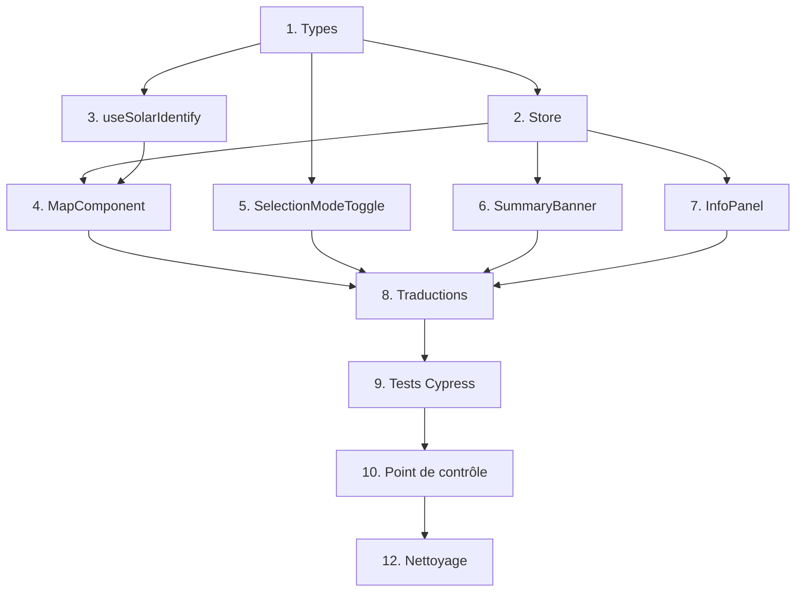

# Implementation Plan — Modes de sélection (as-built)

## Overview

Système de sélection de Sonnendach, livré : deux modes de clic, **Unique** (défaut) et **Multiple**, qui sélectionnent une surface et partagent une sélection unique. S'y ajoutent une bannière de synthèse, un contour sans remplissage, l'orientation avec libellé cardinal pour une surface unique et la sélection du meilleur pan de toit.

Le design initial (modes « Bâtiment » et « Toiture ») a été abandonné. Les tâches 1 à 13 sont **terminées**. La tâche 14 est optionnelle et non commencée.

## Tasks

- [x] 1. Définir les types de sélection
  - Dans `src/types/solar.ts` : `SelectionMode = 'single' | 'multi'`
  - Ajouter `SurfaceData` (avec `orientation` et `tilt` nullables), `AggregatedData` et `SummaryData`
  - Conserver `SuitabilityDistribution` et `SolarMode`
  - _Requirements: 1.4, 6.1, 8.1_

- [x] 2. Refondre le store `mapStore.ts`
  - [x] 2.1 État de sélection
    - `selectedSurfaces` (unique par `featureId`) est l'unique source de vérité
    - `selectionMode` vaut `'single'` par défaut
    - Plus de `roofData`, `facadeData` ni `multiSelectedSurfaces`
    - _Requirements: 1.2, 3.3_
  - [x] 2.2 Agrégation exportée
    - `aggregateSurfaces(surfaces, mode)` : sommes, irradiation pondérée par la surface, répartition par classe, besoins de chaleur dédupliqués par `buildingId`, `orientation` et `tilt` seulement pour une surface
    - `classifyIrradiation` avec les seuils par couche : toitures 800/1000/1200/1400, façades 600/800/1000/1200
    - _Requirements: 6.2, 6.3, 6.4, 6.5, 6.6, 6.8_
  - [x] 2.3 Computeds et actions
    - `aggregated`, `summary` (taux de couverture **non plafonné**, `null` si dénominateur nul) et `hasData`
    - `setSolarMode` vide la sélection ; `setSelectionMode` la conserve
    - `addSurface`, `selectSingle`, `removeSurface`, `toggleSurface`, `clearSelection`
    - _Requirements: 2.1, 3.1, 3.2, 5.1, 5.3, 9.5, 9.6, 10.2_

- [x] 3. Créer le composable `useSolarIdentify.ts`
  - [x] 3.1 Identification d'une surface
    - `identifySurface(coords, layerName)` : `identify` avec tolérance 2, une surface, géométrie GeoJSON
    - `toSurfaceData` convertit les champs allemands de l'API
    - _Requirements: 4.1_
  - [x] 3.2 Meilleur pan
    - `identifyBestRoof(coords, layerName)` : `identify` (tolérance 10 toitures, 40 façades), `find` des surfaces du bâtiment, `pickBestRoof` (max `mstrahlung`, départage par `flaeche`)
    - _Requirements: 4.2, 4.3, 4.4_
  - [x] 3.3 Adresse et commune
    - `lookupAddressCommune(egid, buildingId, layerName)` : EGID d'abord, puis `building_id` vers EGID. Renvoie adresse, commune et code postal
    - _Requirements: 4.5, 13.1_

- [x] 4. Refondre `MapComponent.vue`
  - [x] 4.1 Contour sans remplissage
    - Halo blanc de 5 px sous un trait rouge `#d32f2f` de 2,5 px
    - _Requirements: 7.1, 7.2_
  - [x] 4.2 Flux de clic `identifyAt`
    - `identifySurface`, puis repli sur `identifyBestRoof` ; recherche d'adresse : `identifyBestRoof` directement
    - Mode `single` : `selectSingle`, contours effacés puis redessinés, vue recentrée
    - Mode `multi` : `toggleSurface`, contour ajouté ou retiré par `featureId`
    - `noData` seulement si la sélection est vide
    - Lookup GWR, l'adresse de la recherche prime
    - _Requirements: 2.1, 2.2, 3.1, 3.2, 4.1, 4.2, 4.3, 4.5, 4.6, 4.7, 4.8, 4.9, 7.3_
  - [x] 4.3 Watcher et exposition
    - Watcher sur `solarMode` : remplace la couche de tuiles et efface les contours
    - Pas de watcher sur `selectionMode`
    - `defineExpose({ zoomTo, identifyAt })`, avec `identifyAt` forçant le meilleur pan
    - _Requirements: 5.1, 5.3, 5.4, 7.4_
  - [x] 4.4 Bouton « Nouvelle sélection »
    - Visible seulement en mode `multi` avec une sélection non vide
    - Clic : `outlineSource.clear()` puis `store.clearSelection()`
    - _Requirements: 2.3, 10.1, 10.2, 10.3_

- [x] 5. Créer `SelectionModeToggle.vue`
  - Deux boutons `mode_single` et `mode_multi` sous `mode_selection_label`, indicateur glissant de 0 % à 100 %
  - _Requirements: 1.1, 1.2, 1.3_

- [x] 6. Créer `SummaryBanner.vue`
  - [x] 6.1 Composant
    - Aptitude globale colorée, `summary_pv` avec `{amount}`, `summary_heat` avec `{percent}` si non nul
    - _Requirements: 9.2, 9.3, 9.4, 9.6_
  - [x] 6.2 Insertion dans `SonnendachView.vue`
    - Ordre : `MapComponent`, `SelectionModeToggle`, `SummaryBanner`, `InfoPanel`
    - _Requirements: 9.1, 9.8_

- [x] 7. Adapter `InfoPanel.vue`
  - Lire `store.aggregated` ; titre `info_selection_title`, nombre de surfaces et adresse
  - Orientation avec libellé cardinal (`fmtOrientation`) et inclinaison (`fmtDeg`) pour une surface unique, `-` si absents
  - Ligne « Couverture des besoins » si le taux est non nul
  - Lien du calculateur solaire, prérempli pour une seule surface de toiture
  - _Requirements: 6.1, 8.1, 8.2, 8.3, 8.4, 8.5, 8.6, 9.7, 11.1, 11.2, 11.3, 11.4, 11.5, 11.6, 11.7_

- [x] 8. Traductions (de, fr, it, en)
  - Ajouter `mode_selection_label`, `mode_single`, `mode_multi`, `mode_new_selection`, `info_selection_title`, `info_surfaces`, `info_orientation`, `info_inclination`, `info_heat_coverage`, `cardinal_*` et `summary_*`
  - Retirer les clés obsolètes de l'ancien design
  - _Requirements: 12.1, 12.2, 12.3_

- [x] 9. Tests Cypress
  - [x] 9.1 Réécrire `cypress/e2e/selection-mode.cy.ts` (5 tests)
    - Toggle « Einzeln » par défaut, InfoPanel « Information », bannière avec « CHF », pas de bouton d'effacement en mode Unique, mode Multiple et effacement
    - _Requirements: 13.2_
  - [x] 9.2 Adapter `mode-toggle.cy.ts` et `language.cy.ts`
    - Le titre « Information » et la sélection effacée au changement de couche ; espace avant le `?` dans les titres français
    - _Requirements: 5.3, 13.3_

- [x] 10. Point de contrôle
  - lint : 0 erreur. type-check : OK. build : OK. E2E : 31/31 (avant l'ajout de la tâche 13)

- [x] 11. Abandon du mode « Bâtiment »
  - Décision de ne pas livrer `identifyBuilding`, `toggleBuilding`, `SelectionMode = 'building' | 'roof'` ni les clés `mode_building` et `mode_roof`
  - Documenté dans « Décisions abandonnées » des requirements
  - _Requirements: 1.4, 1.5, 12.2_

- [x] 12. Nettoyage du code et de l'internationalisation
  - [x] 12.1 Code mort
    - Supprimer `lastBuildingId`, le type `Coordinates`, les alias `RoofData` et `FacadeData`, `useDevice.ts` et la dépendance `vue3-openlayers`
    - Typer `onMapClick(evt: MapBrowserEvent)`
    - _Requirements: 13.4_
  - [x] 12.2 Textes en dur passés en i18n
    - `map_attribution`, `basemap_satellite`, `basemap_grey`, `search_clear`, `language_label`
    - _Requirements: 12.4_

- [x] 13. Tester la logique de sélection sans navigateur
  - Créer `cypress/e2e/selection-logic.cy.ts` (9 tests, sans `cy.visit`) : import direct de `aggregateSurfaces` et `useMapStore`, Pinia neuf avant chaque test du store
  - Agrégation : sommes et irradiation pondérée, besoins de chaleur comptés une fois par bâtiment, seuils de classe par couche (valeurs limites), répartition par classe, orientation pour une surface unique
  - Store : unicité et toggle, mode Unique qui remplace, conservation de la sélection au changement de mode, effacement au changement de couche, taux de couverture non plafonné et `null`
  - Le même fichier tourne avec `npm run test:e2e` : aucun outil de test supplémentaire
  - _Requirements: 13.3, 6.2, 6.4, 6.6, 9.5, 9.6_

- [ ]* 14. Compléter la couverture de test (optionnel)
  - [ ]* 14.1 Cumul dans l'interface
    - Mode Multiple avec deux surfaces différentes, puis retrait par un second clic
    - _Requirements: 3.1, 3.2_
  - [ ]* 14.2 Orientation avec libellé cardinal
    - Ajouter `ausrichtung` et `neigung` aux fixtures et vérifier « -13° (Sud) » pour une surface
    - _Requirements: 8.3_
  - [ ]* 14.3 Tests de `pickBestRoof`
    - Exporter la fonction ou la tester par le composable, avec des surfaces à `mstrahlung` égal puis différent
    - _Requirements: 4.4_

## Notes

- Application multilingue : toute clé ajoutée doit exister dans les 4 locales. Les fichiers de langue gardent leur BOM et leurs fins de ligne CRLF
- La persistance de la sélection joue entre les **modes de sélection**, pas entre les **couches**
- `npm` s'exécute en local avec `npm.cmd` dans PowerShell (la politique d'exécution bloque `npm.ps1`)
- Ces tâches décrivent le travail déjà livré. Les tâches optionnelles (14) n'ont pas été lancées

## Task Dependency Graph



```json
{
  "waves": [
    { "id": 0, "tasks": ["1"] },
    { "id": 1, "tasks": ["2", "3", "5"] },
    { "id": 2, "tasks": ["4", "6", "7"] },
    { "id": 3, "tasks": ["8"] },
    { "id": 4, "tasks": ["9.1", "9.2"] },
    { "id": 5, "tasks": ["12.1", "12.2", "13"] }
  ]
}
```
